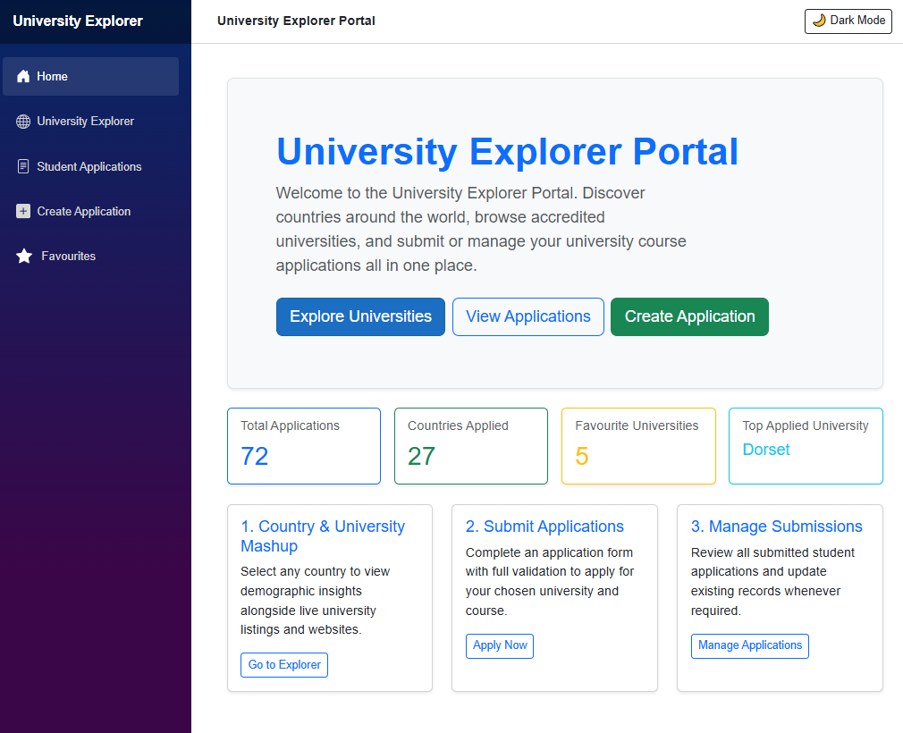
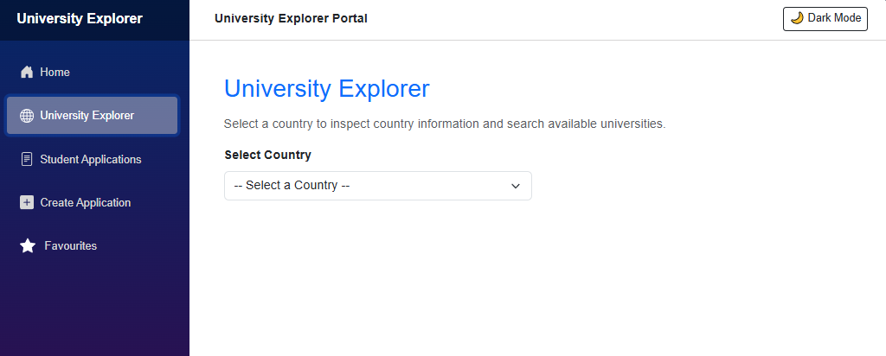
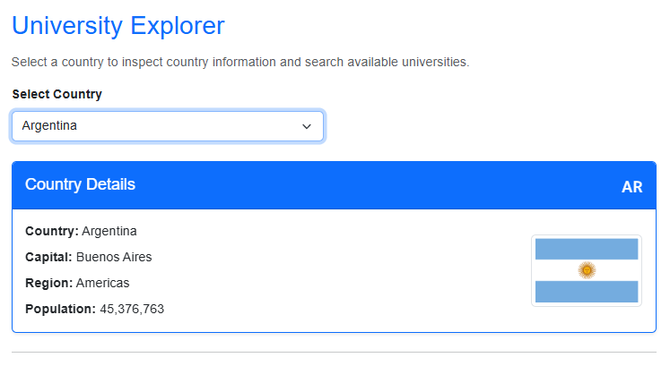
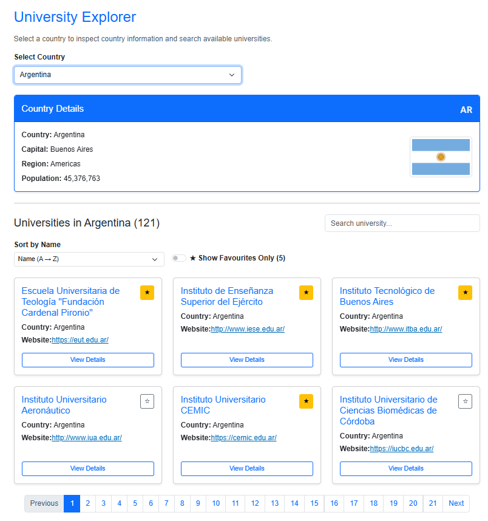
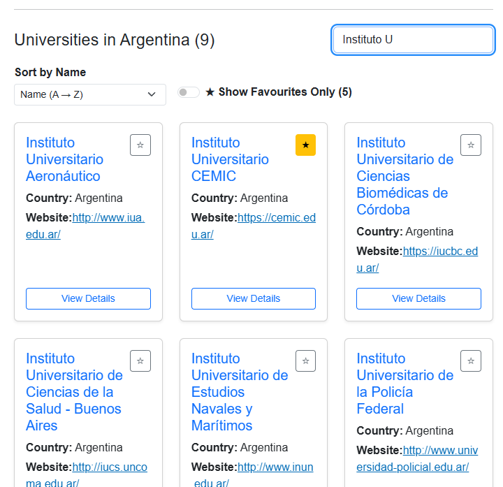
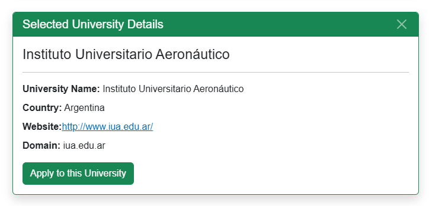
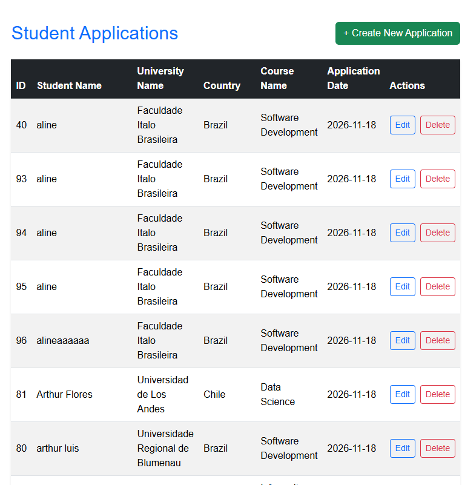
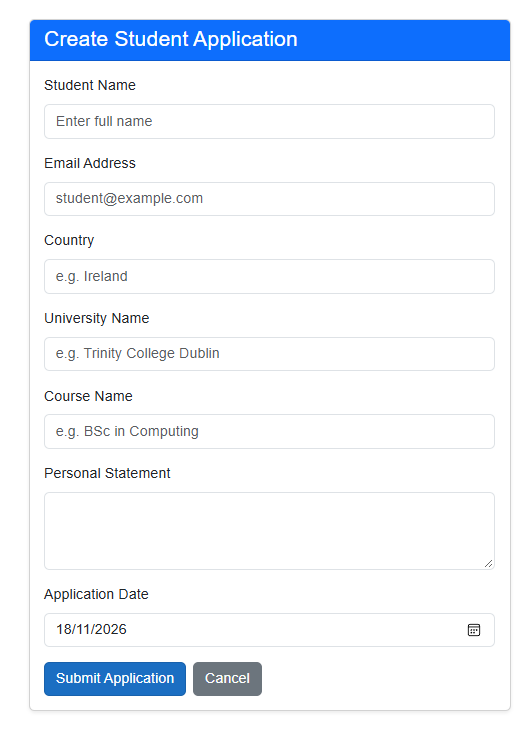
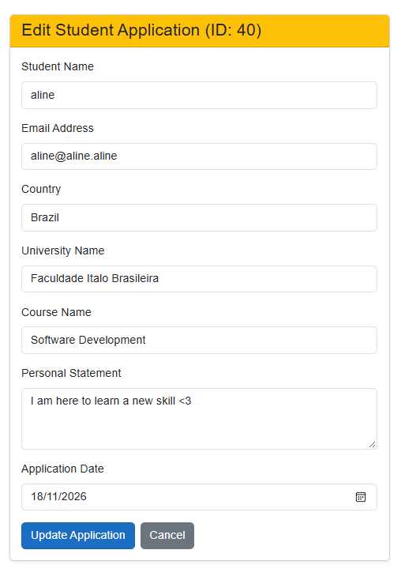

# University Explorer Portal

A modern, interactive **Blazor Server** web application built with .NET that allows users to explore countries worldwide, browse accredited universities, and submit or manage student course applications through RESTful API integrations.

---

## Key Features

- **Country & University Explorer (`/university-explorer`)**:
  - Browse countries with demographic insights alongside live university listings and official websites.
  - Direct integration to pre-fill application forms with selected country and university details.
- **Student Applications Management (`/student-applications`)**:
  - View all submitted student applications in a clean, responsive table.
  - Full CRUD support connected to an external REST API (`GET`, `POST`, `PUT`).
- **Create Application (`/student-applications/create`)**:
  - Interactive form with Data Annotations validation (`StudentName`, `Email`, `Country`, `University`, `Course`, `PersonalStatement`, and `ApplicationDate`).
- **Edit Application (`/student-applications/edit/{id}`)**:
  - Load existing application records by ID and update details seamlessly.

---

## Tech Stack & Architecture

- **Framework**: ASP.NET Core Blazor Web App (Interactive Server Render Mode)
- **UI & Styling**: Bootstrap 5, Custom Scoped CSS (`MainLayout.razor.css`, `NavMenu.razor.css`), and SVG icons
- **Architecture**:
  - `Models/`: Strongly-typed data models (`Country`, `University`, `StudentApplication`) with JSON serialization attributes and validation rules.
  - `Services/`: Dependency-injected HTTP client services (`CountryService`, `UniversityService`, `StudentApplicationService`).
  - `Components/Pages/`: Routable interactive pages (`Home`, `UniversityExplorer`, `StudentApplications`, `CreateStudentApplication`, `EditStudentApplication`).
  - `Components/`: Reusable UI components (`StudentApplicationForm`, `CountryDetails`, `UniversityCard`, `UniversityDetails`).

---

## External APIs Integrated

- **Student Applications API**: `https://edutots.net/api/studentapplication` (CRUD operations for student course applications)
- **Countries & Universities Data**: Consumed via `CountryService` and `UniversityService`

---

## Getting Started


### Running Locally

1. **Clone the repository**:
   ```bash
   git clone [https://github.com/nikov280/UniversityExplorerPortal.git](https://github.com/nikov280/UniversityExplorerPortal.git)
   cd UniversityExplorerPortal

###Project Structure

```text
UniversityExplorerPortal/
├── Components/
│   ├── Layout/
│   │   ├── MainLayout.razor
│   │   └── NavMenu.razor
│   ├── Pages/
│   │   ├── Home.razor
│   │   ├── UniversityExplorer.razor
│   │   ├── StudentApplications.razor
│   │   ├── CreateStudentApplication.razor
│   │   ├── EditStudentApplication.razor
│   │   └── FavouriteUniversities.razor
│   ├── CountryDetails.razor
│   ├── StudentApplicationForm.razor
│   ├── UniversityCard.razor
│   └── UniversityDetails.razor
├── Models/
│   ├── Country.cs
│   ├── StudentApplication.cs
│   └── University.cs
├── Services/
│   ├── CountryService.cs
│   ├── LocalStorageService.cs
│   ├── StudentApplicationService.cs
│   └── UniversityService.cs
├── Program.cs
└── README.md
```

###Screenshoots

1.	**Home Page**
	
2.	**University Explorer Page**
	
3.	**Country selected and details displayed**
	
4.	**Universities loaded for a selected country**
	
5.	**University search functionality**
	
6.	**University details displayed**
	
7.	**Student Applications page (GET)**
	
8.	**Create Student Application page (POST)**
	
9.	**Edit Student Application page (PUT)**
	

